# Análise do VR — podium-vr

**Data:** 2026-09-22 · **Branch:** `feat/transcricao-local-e-quest` · **Unity:** 6000.5.10f1 ·
**Aparelho de referência:** Meta Quest 3 (runtime Oculus 1.207.0, pelo Quest Link)

Pedido analisado:

1. Analisar o projeto.
2. Melhorar o cenário para o VR.
3. O menu com as ações disponíveis não aparecia.
4. Reconhecer os comandos tanto dos controles quanto das mãos.
5. Registrar tudo num arquivo de análise — este.

---

## Resumo

**O menu existia, mas nascia de costas.** O `PainelEmVR` girava o quadro 180° + 28°, como se
um Canvas fosse lido pela frente (+Z) — é o contrário. Resultado no headset: um painel
espelhado, visto quase de perfil (16,5° de largura aparente em vez de ~52°), com a fileira
de botões atrás do tampo do púlpito. Nas capturas abaixo, a mesma cena antes e depois.

**Controle e mão não geravam entrada nenhuma.** Todos os perfis de interação do OpenXR
estavam desligados. O log da sessão de 2026-09-20 no Quest 3 registra literalmente
`Action Sets: No action sets registered`: sem perfil, o runtime não entrega controle nem
mão ao app — não há raio, não há gatilho, não há pinça.

Os dois foram corrigidos, junto com outros seis defeitos do painel e do rig encontrados no
caminho (botão "Nova sessão" morto no headset, nenhum jeito de verificar a API de novo
dentro do VR, realce de mira apagado a cada quadro, entre outros). As mãos passaram a
funcionar **sem pacote novo**, pelo perfil padrão do OpenXR (`XR_EXT_hand_interaction`),
que o Quest 3 anuncia no próprio log. Ganharam-se comandos que não pedem mira (A/B/X/Y para
slides e perguntas, Menu e pinça longa para trazer o painel) e o cenário ficou mais leve e
mais nítido no Quest.

**Verificado aqui, em modo de lote:** compilação sem erro, 43 de 43 testes (16 novos),
validação do OpenXR e capturas renderizadas da visão de quem apresenta. **Falta vestir o
headset** — o roteiro de conferência está na seção 9.

| Antes | Depois |
|---|---|
| 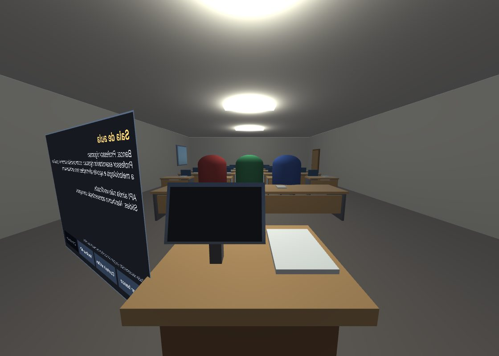 | 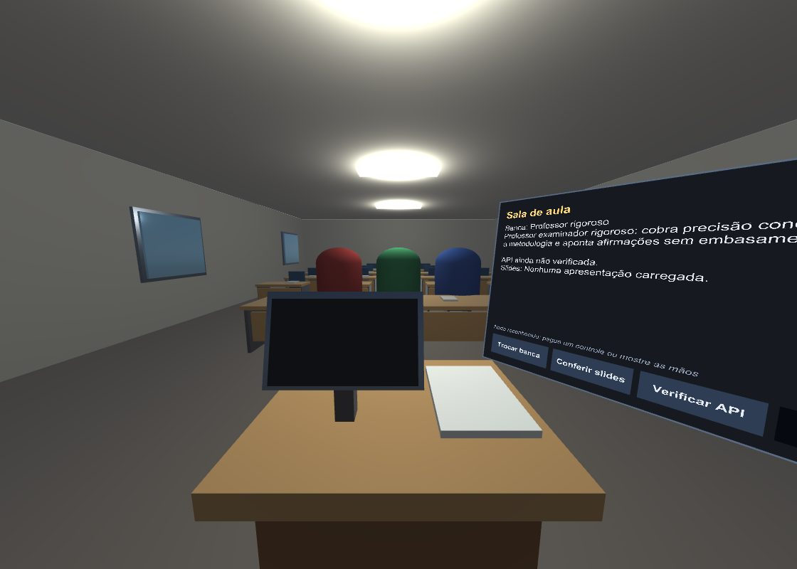 |
| O painel à esquerda, de costas (texto espelhado), quase de perfil e com os botões atrás do púlpito. | O painel à direita do púlpito, virado para quem apresenta; a banca fica livre à frente. |

---

## 1. Como a análise foi feita

**Código lido por inteiro:** `PodiumXRRig`, `PainelEmVR`, `SalaDeAulaController`,
`SalaDeAulaCenografia`, `PodiumSession`, `ApresentacaoDeSlides`, `TelaDeSlides`, os
scripts de Editor (`PodiumQuestSetup`, `PodiumSalaSetup`, `PodiumSalaPreview`) e os testes.
Trechos do resto (`TranscritorLocal`, `PresentationRecorder`, DTOs).

**Configuração lida:** a cena `SalaDeAula.unity` (ligações de cada componente),
`OpenXR Package Settings.asset` (cada recurso e o `m_enabled` dele), `XRGeneralSettings`,
`ProjectSettings` (entrada, qualidade, Android), os assets de URP e o prefab
`XR Origin (XR Rig)` das Starter Assets (hierarquia, `XRInputModalityManager`,
locomoção) e o `XRI Default Input Actions` (todas as ligações).

**Evidência de execução:** `Logs/Editor.log` da sessão de 2026-09-20 às 20:30, em que a
cena rodou num Meta Quest 3 pelo Link. É dele que saem as citações com número de linha.
(O Unity gira esse arquivo ao abrir o Editor de novo; as linhas que importam estão
transcritas aqui.)

**Fonte dos pacotes**, em `Library/PackageCache`, para não supor comportamento: XR
Management 4.6.1 (quando o XR sobe), XR Interaction Toolkit 3.6.1 (troca controle ↔ mão,
raio sobre interface), OpenXR 1.18.0 (perfil de mão, recursos da Meta, validação) e Input
System 1.20.0 (`TrackedPoseDriver`).

**Execução em modo de lote** (o Editor estava fechado), sempre com o log fora do projeto:
`PodiumQuestSetup.Preparar`, `PodiumSalaSetup.Ligar`, `PodiumQuestSetup.ConferirValidacao`,
os testes de EditMode e um script de captura temporário (seção 8), apagado ao final.

---

## 2. O projeto, em uma página

O cliente Unity do Podium grava a apresentação, conversa com o backend (`../podium`) e
mostra o Feedback Duplo. A cena `SalaDeAula.unity` tem um objeto só que importa, `Podium`,
com o fluxo inteiro:

| Peça | Papel |
|---|---|
| `PodiumApiClient` · `PodiumSession` | as oito rotas da API e a máquina de estados da sessão (`Idle → Initializing → Ready → Recording → Uploading → Analyzing → Completed/Failed`) |
| `PresentationRecorder` · `TranscritorLocal` · `WhisperManager` | microfone em pedaços de 60 s e transcrição no aparelho (whisper.cpp) |
| `SalaDeAulaController` | decide o fluxo e desenha o painel IMGUI do PC |
| `SalaDeAulaCenografia` · `ApresentacaoDeSlides` | a sala de primitivos, montada em `Start()`, e os slides na parede e no monitor do púlpito |
| `PodiumXRRig` · `PainelEmVR` | **o VR**: o rig das Starter Assets do XRI quando há headset; o painel em world space, porque o IMGUI não chega ao headset |
| `ComandosDoApresentador` | **novo**: botões do controle e gestos da mão |

No PC, sem headset, nada de VR entra em cena: câmera fixa e painel IMGUI. Com headset, o
`PodiumXRRig` instancia o rig, desliga a câmera da cena, e o `PainelEmVR` assume a
interface. Esse desenho estava certo; o que falhava era a execução dele.

---

## 3. Por que o menu não aparecia

| # | Defeito | Evidência | Efeito no headset | Gravidade |
|---|---|---|---|---|
| 1 | Painel girado ao contrário | `PainelEmVR.cs` (versão anterior, linha 139): `Quaternion.Euler(0f, 180f + anguloDeVirada, 0f)` | de costas: texto espelhado | **crítica** |
| 2 | Painel quase de perfil | geometria abaixo | 16,5° de largura aparente em vez de ~52° | **crítica** |
| 3 | Botões atrás do púlpito | borda de baixo a 0,96 m; tampo do púlpito a 1,10–1,16 m | a fileira de botões some atrás do tampo | alta |
| 4 | Botões desligados e religados a cada quadro | `Redesenhar()` anterior, linhas 298–302 | o realce de mira nunca aparece; parece que o raio não reconhece o botão | alta |
| 5 | Nenhum "Verificar API" no headset | log linha 870: `Curl error 7: Failed to connect to localhost port 8000` | com a API fora do ar na abertura, "Criar sessão" fica apagado para sempre dentro do VR | alta |
| 6 | "Nova sessão" sem efeito no headset | o painel olhava só `session.State`, que continua `Completed` | o botão não faz nada | média |
| 7 | Decisão tomada uma vez só | rig montado só no `Awake`, painel só no `Start` | se o headset ficasse ativo um quadro depois, nunca haveria rig nem painel | média (robustez) |
| 8 | Sem prefab, sem painel | `EmHeadset` era `rig != null`, e o caminho sem prefab não preenchia `rig` | headset sem painel; e a cabeça dependia de um `TrackedPoseDriver` criado em tempo de execução sem nenhuma ligação | baixa (não é o caso da cena) |
| 9 | Borda por cima do fundo | a borda era filha do objeto que desenha o fundo | painel cinza-azulado no lugar do fundo escuro | cosmética |

**A regra que o código inverteu.** Um Canvas em world space se lê pelo lado de −Z: a frente
dele (+Z) aponta para *longe* de quem olha. É a mesma regra do raio do XR Interaction
Toolkit — `TrackedDeviceGraphicRaycaster.cs`, linhas 564–568 — que só considera o gráfico de
frente quando `Vector3.Dot(direção do raio, frente do gráfico) > 0`.

**A geometria da pose antiga.** Olho em (0; 1,6; 0), painel em (−0,85; 1,35; 0,75) girado
208° em Y:

- a linha de visão chega ao painel a **76,5° da normal** dele (cosseno 0,23);
- as bordas ficam em −53° e −36,5° de azimute: **16,5° de largura aparente**, contra ~52°
  se estivesse de frente;
- o canto de baixo mais perto de quem apresenta, em (−0,36; 0,96; 0,49), fica **embaixo do
  tampo** do púlpito (o tampo vai de x −0,38 a 0,38 e de z 0,38 a 0,92, a 1,10–1,16 m de
  altura): de onde quem apresenta olha, o tampo tapa justamente a fileira de botões.

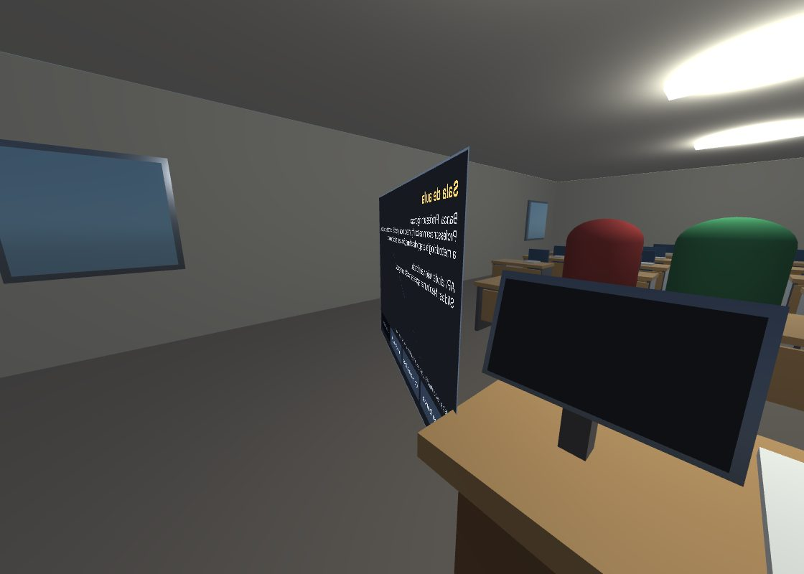

*Captura da pose antiga, olhando direto para o painel: "Sala de aula" aparece espelhado e
o quadro, de perfil.*

---

## 4. Por que controle e mão não eram reconhecidos

**Nenhum perfil de interação ligado.** Em `Assets/XR/Settings/OpenXR Package Settings.asset`
estavam com `m_enabled: 0`, em Android e em Standalone: *Oculus Touch Controller Profile*,
*Meta Quest Touch Plus Controller Profile*, *Meta Quest Touch Pro Controller Profile* e
*Hand Interaction Profile*. O log da sessão no Quest 3 confirma o efeito:

```
[Editor.log:815]  Features requested to be enabled: (0)
[Editor.log:829]  Action Sets: No action sets registered
```

Sem perfil, o runtime não sabe que o app entende controles — e não entrega nenhum. O rig
existia, mas os controles nunca eram rastreados: sem raio, sem gatilho, sem clique.

**"Meta Quest Support" desligado no Android.** É esse recurso que põe no manifesto o que faz
o Quest abrir o app como VR (e não como janela plana) e declara os aparelhos suportados.
Sem ele, a build de Android não se declarava como app de Quest. (Pelo Link, que usa as
configurações de Standalone, isso não aparecia — só na build.)

**O rig não tinha mãos.** O `XRInputModalityManager` do prefab das Starter Assets tem
`m_LeftHand` e `m_RightHand` vazios. Sem o pacote XR Hands, a detecção de mão rastreada do
XRI sempre responde "não" (`XRInputModalityManager.cs`, `GetLeftHandIsTracked`).

**O caminho que resolve sem pacote novo.** Três fatos, todos verificados na fonte:

1. o runtime do Quest 3 anuncia `XR_EXT_hand_interaction` (log, linha 756);
2. no OpenXR 1.18, esse perfil cria o dispositivo `HandInteraction`, que **é um
   `XRController`** com `pointerPosition`, `pointerRotation` (a mira da mão) e
   `pointerActivated` (a pinça) — `HandInteractionProfile.cs`, linhas 47–143;
3. o `XRI Default Input Actions` das Starter Assets já liga `UI Press` a
   `<HandInteraction>{LeftHand}/pointerActivated` e a posição do lado esquerdo a
   `<XRController>{LeftHand}/pointerPosition`; e o `XRInputModalityManager`, sem XR Hands,
   trata o `HandInteraction` rastreado como controle (`UpdateLeftMode`, "MotionController").

Ou seja: ligando o perfil de mão, a mão passa a dirigir o mesmo raio do controle, e a pinça
aperta os mesmos botões. Não entra XR Hands, nem SDK da Meta — o projeto continua em OpenXR
puro, como o README defende.

**Nada funcionava sem mira.** Não havia comando de controle além do gatilho no raio. E o
botão A estava ocupado pelo pulo (`XRI Right Locomotion/Jump` → `{PrimaryButton}`), o que
impediria usá-lo para passar slide.

---

## 5. O cenário no VR — o que foi encontrado

| Achado | Onde | Por que importa no Quest |
|---|---|---|
| MSAA desligado | `Mobile_RPAsset.asset`: `m_MSAA: 1` | serrilhado cintilando em toda borda — no VR incomoda mais que no monitor |
| HDR ligado | `m_SupportsHDR: 1` | a cena não tem pós-processamento; HDR só força uma cópia da imagem inteira a cada quadro |
| 80% da resolução | `m_RenderScale: 0.8` | texto do painel borrado a um metro dos olhos |
| Sol com sombra atrás de um teto fechado | `Directional Light` com sombras; `comTeto` ligado | o sol não ilumina a sala: só **vaza** pelas junções do teto com as paredes, em faixas serrilhadas e manchas no chão (captura na seção 8) — que no headset cintilam com a cabeça — e custa o mapa de sombras a cada quadro |
| Rig anda pelo analógico e pula | Starter Assets: `Move` e `Jump` ativos | andar pelo analógico enjoa e tira a pessoa do púlpito; o pulo ocupa o A |
| Nenhuma referência no chão | — | o lugar físico da pessoa raramente coincide com o ponto de nascimento |
| Latência priorizando a renderização | OpenXR Android: `m_latencyOptimization: 0` | a validação do Meta Quest Support recomenda priorizar a leitura da entrada |

---

## 6. O que foi feito

### Arquivo por arquivo

| Arquivo | O que mudou |
|---|---|
| `Assets/Podium/Runtime/XR/PainelEmVR.cs` | **Reescrito.** Vira para o olho (`VoltadoPara`); fica à **direita** do púlpito em (0,85; 1,45; 0,80), porque à esquerda o monitor de retorno tapava os botões; reorienta-se sozinho se a pessoa se afastar mais de 12°; `TrazerParaPerto()` o recoloca junto da cabeça; 4 botões que só mudam quando precisam; *Verificar API* no lobby; *Nova sessão* funcionando; tela de **Resumo** (forma, cobertura, fonte da transcrição, análise de conteúdo); linha de ajuda com o modo de entrada; rótulo esmaecido em botão desabilitado; texto que encolhe em vez de cortar; redesenho a 10 Hz sem lixo de memória por quadro; monta-se assim que o headset aparecer, não só no `Start`. |
| `Assets/Podium/Runtime/XR/ComandosDoApresentador.cs` | **Novo.** A/X avança e B/Y volta (slides na fala, perguntas no feedback); Menu do controle esquerdo traz o painel; pinça segurada ~0,9 s fora do painel faz o mesmo com a mão; vibração curta de confirmação; detecta se cada lado é controle ou mão e esconde o modelo do controle quando é a mão que aponta. |
| `Assets/Podium/Runtime/XR/PodiumXRRig.cs` | Espera o headset ficar ativo em vez de decidir uma vez no `Awake`; desliga andar contínuo e pulo (`paradoNoPulpito`), mantendo giro e teletransporte; sem prefab, monta um XR Origin mínimo com o rastreamento da cabeça ligado de verdade. |
| `Assets/Podium/Runtime/Session/SalaDeAulaController.cs` | Expõe `NoLobby`, `NoNavegadorDePerguntas` e `VerificandoApi` — o que o painel do headset precisava e não tinha. |
| `Assets/Podium/Runtime/Scenarios/SalaDeAulaCenografia.cs` | Marca no chão onde quem apresenta fica, com a ponta para a banca; com teto, desliga a luz direcional no Play — some o vazamento de luz e o custo do mapa de sombras. |
| `Assets/Editor/PodiumQuestSetup.cs` | Liga os perfis de controle e de mão (Android e Standalone) e o Meta Quest Support; latência priorizando a entrada no Android; URP do Quest com MSAA 4x, sem HDR e escala 1,0; novo menu **Podium > Conferir a validação do OpenXR**. |
| `Assets/Editor/PodiumSalaSetup.cs` | Põe e liga o `ComandosDoApresentador` na cena. |
| `Assets/Podium/Scenes/SalaDeAula.unity` | Via `PodiumSalaSetup.Ligar`: o componente novo e os campos novos; saem `posicao` e `anguloDeVirada`. |
| `Assets/XR/Settings/OpenXR Package Settings.asset` | Via `PodiumQuestSetup.Preparar`: 9 recursos ligados e a latência do Android. O pacote marcou sozinho dois sinalizadores de migração (`m_hasMigratedMultiviewRenderRegion…`). |
| `Assets/Settings/Mobile_RPAsset.asset` | `m_MSAA: 4`, `m_SupportsHDR: 0`, `m_RenderScale: 1`. |
| `ProjectSettings/QualitySettings.asset` | `antiAliasing: 4` no nível Mobile — o Unity espelha ali o MSAA do asset de URP. |
| `Assets/Tests/EditMode/PainelEmVRTests.cs` · `ComandosDoApresentadorTests.cs` | **Novos**, 16 testes (seção 8). |
| `README.md` | Estado atual, estrutura, testes (43), passos do Quest, a interface no headset com a tabela de comandos e a linha "mãos" do fora de escopo. |
| `docs/ANALISE-VR.md` · `docs/analise-vr/*.jpg` | Este arquivo e as capturas. |

**Nada foi commitado.** As mudanças estão no diretório de trabalho para você revisar.

### Os recursos do OpenXR, depois

| Recurso | Android | Standalone (Link) |
|---|---|---|
| Oculus Touch Controller Profile (Quest 2) | ligado | ligado |
| Meta Quest Touch Plus Controller Profile (Quest 3/3S) | ligado | ligado |
| Meta Quest Touch Pro Controller Profile | ligado | ligado |
| Hand Interaction Profile (`XR_EXT_hand_interaction`) | ligado | ligado |
| Meta Quest Support | ligado | — (só existe no Android) |
| Latency Optimization | Prioritize Input Polling | inalterado |

---

## 7. Os comandos, tela por tela

| Tela | Botões do painel | A ou X | B ou Y | Menu (controle) ou pinça longa (mão) |
|---|---|---|---|---|
| Lobby (antes da sessão, após falha ou após *Nova sessão*) | Trocar banca · Conferir slides · Verificar API · Criar sessão | próximo slide, se já conferidos | slide anterior | traz o painel |
| Criando a sessão | — | slides | slides | traz o painel |
| A banca está sentada | Começar · Slide anterior · Próximo slide | próximo slide | slide anterior | traz o painel |
| Gravando | Encerrar · Slide anterior · Próximo slide | próximo slide | slide anterior | traz o painel |
| Enviando / Analisando | — | slides | slides | traz o painel |
| Feedback — pergunta | Anterior · Próxima · Resumo · Nova sessão | próxima pergunta (a tela da sala vai ao slide de origem dela) | pergunta anterior | traz o painel |
| Feedback — resumo | Perguntas · Nova sessão | próxima pergunta (e volta à tela da pergunta) | pergunta anterior | traz o painel |

Os botões do painel se apertam **apontando e apertando o gatilho** (controle) ou **apontando
e fazendo a pinça** (mão). A mesma regra das setas do PC decide para onde vão A e B: no
navegador de perguntas, perguntas; no resto, slides. Recentralizar a sala continua sendo
do sistema (segurar o botão da Meta, ou o gesto de recentralizar com a mão).

A linha de ajuda do painel muda com o que o headset está lendo — é o jeito de saber, de
dentro do VR, se o controle ou a mão foram reconhecidos:

| Modo | Linha de ajuda |
|---|---|
| Controles | *Controle: gatilho aperta · A/X avança · B/Y volta · Menu traz o painel* |
| Mãos | *Mãos: pinça aperta · pinça segurada fora do painel traz o painel* |
| Nada | *Nada reconhecido: pegue um controle ou mostre as mãos* |

---

## 8. Verificação executada

**Compilação.** Sem erro em todas as execuções em modo de lote.

**`PodiumQuestSetup.Preparar`** (o que ele ligou, somando as duas execuções — a latência
entrou na segunda, depois que a validação a recomendou):

```
· OpenXR: OculusTouchControllerProfile (Android), MetaQuestTouchPlusControllerProfile (Android),
  MetaQuestTouchProControllerProfile (Android), HandInteractionProfile (Android),
  MetaQuestFeature (Android), OculusTouchControllerProfile (Standalone),
  MetaQuestTouchPlusControllerProfile (Standalone), MetaQuestTouchProControllerProfile
  (Standalone), HandInteractionProfile (Standalone)
· OpenXR: latência priorizando a leitura da entrada (Android)
· URP do Quest: MSAA 4x, sem HDR, escala 1,0 (Mobile_RPAsset)
```

**`PodiumSalaSetup.Ligar`:** `ComandosDoApresentador adicionado`; o resto já estava na cena.

**Validação do OpenXR** (`Podium > Conferir a validação do OpenXR`):

```
· Android: aviso Using the Screen Space Ambient Occlusion render feature results in
  significant performance overhead ...
· Standalone: nenhum problema
```

O aviso de SSAO é falso positivo para o Quest: a regra varre *todos* os assets de URP do
projeto, e o SSAO só existe no `PC_Renderer`, cujo nível de qualidade exclui o Android. O
`Mobile_Renderer`, o do Quest, não tem nenhum recurso de renderização.

No caminho apareceu um **defeito do próprio OpenXR 1.18**: uma regra de validação do Meta
Quest Support lê as configurações do grupo *selecionado* no Editor, e não do validado — com
o Standalone selecionado, validar o Android estoura com `NullReferenceException`
(`MetaQuestFeature.cs:539`). A conferência seleciona o grupo antes de validar e devolve a
seleção depois; a plataforma ativa não muda.

**Testes de EditMode: 43 de 43 passando** (27 que já existiam + 16 novos):

| `PainelEmVRTests` | `ComandosDoApresentadorTests` |
|---|---|
| FrenteDoPainelApontaNaDirecaoDoOlhar | NoFeedbackOsComandosAndamNasPerguntas |
| PainelDeQualquerLadoFicaDeFrente | ForaDoFeedbackOsComandosAndamNosSlides |
| PainelNaoTombaDeLado | SemSlidesNemPerguntasOBotaoNaoFazNada |
| OlhoNoProprioPainelNaoGeraRotacaoInvalida | MaosSaoReconhecidasComoMaos |
| ResumoTrazPerguntasFormaCoberturaEFonte | ControlesDaMetaSaoControles |
| CoberturaNaoMedidaNaoViraZero | SemLayoutNaoHaMao |
| AnaliseLongaECortadaComAviso | ControleEmUmLadoBastaParaAAjudaFalarDeBotoes |
| SemFeedbackOResumoFicaVazio | SoMaosViramModoDeMaos |

**Capturas da visão de quem apresenta.** Um script de Editor temporário abriu a cena,
montou a sala pela pré-visualização, construiu o painel e renderizou do ponto dos olhos
(0; 1,6; 0), no nível de qualidade Mobile — o do Quest. Os estados do painel (gravando,
pergunta, resumo) foram simulados só nesse script. Ele foi apagado ao final.

A captura pegou um defeito meu antes de ele chegar a você: eu guardava o `Transform` do
painel antes de adicionar o `Canvas`, e o Unity troca o `Transform` por um `RectTransform`
nessa hora — o painel ficava na origem, no chão, sem erro nenhum. Corrigido em
`PainelEmVR.Construir()`, com um comentário explicando.

| | |
|---|---|
| 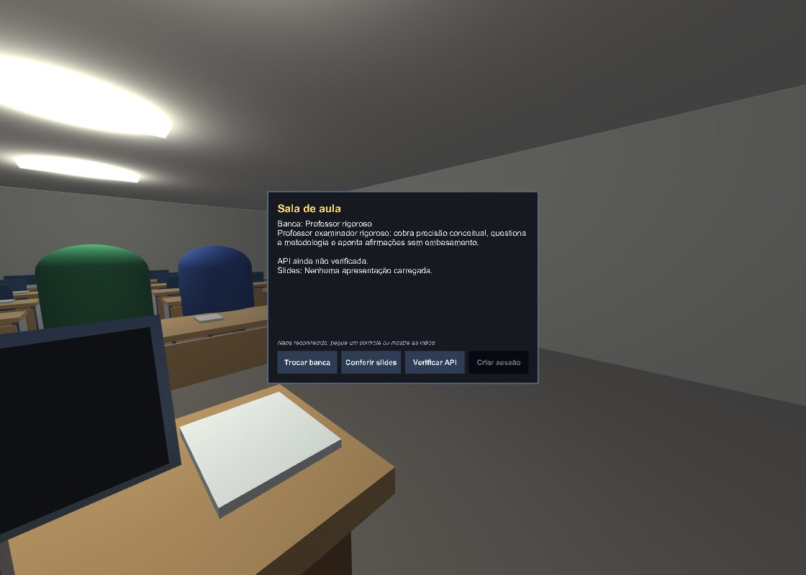 | 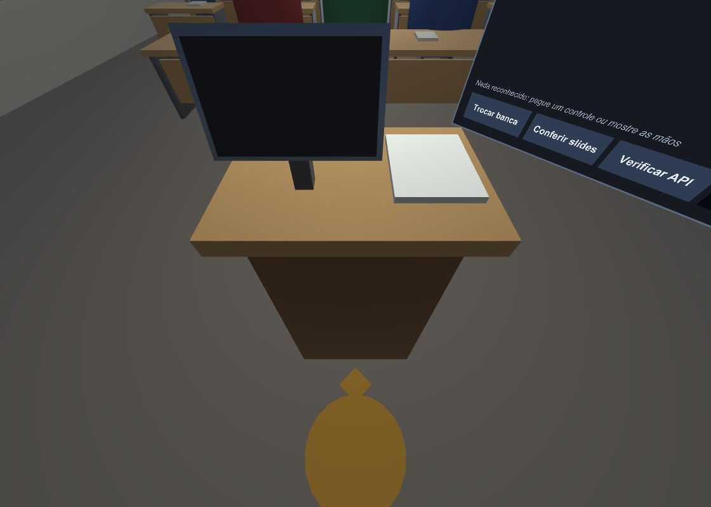 |
| O painel no lugar novo, com o púlpito e o monitor de retorno em primeiro plano. | A marca no chão: o disco onde ficar e a ponta para a banca. |
| 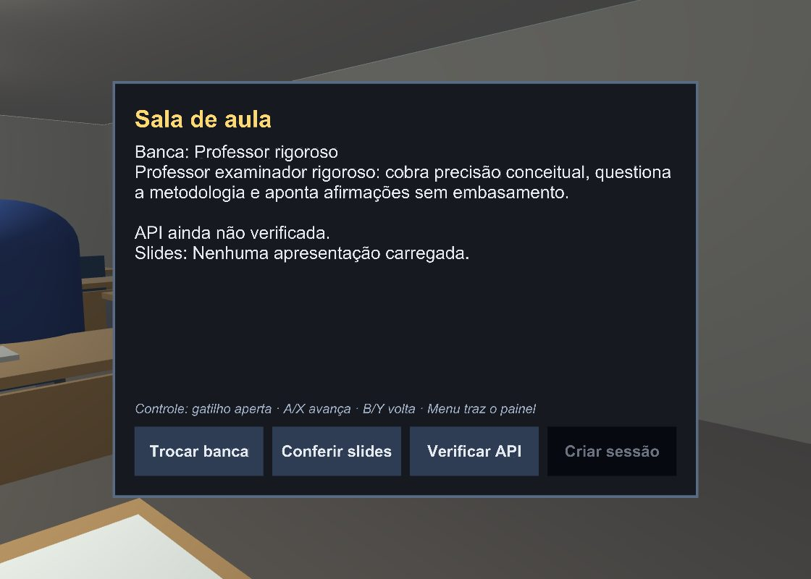 | 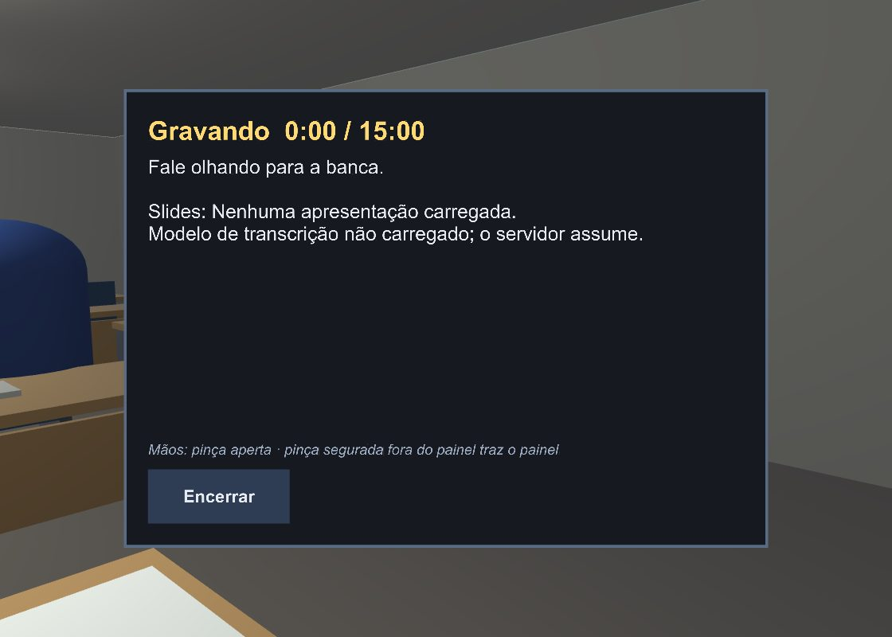 |
| Lobby: *Verificar API* novo; *Criar sessão* esmaecido enquanto a API não responde. | Gravando, com o headset lendo as mãos. |
| 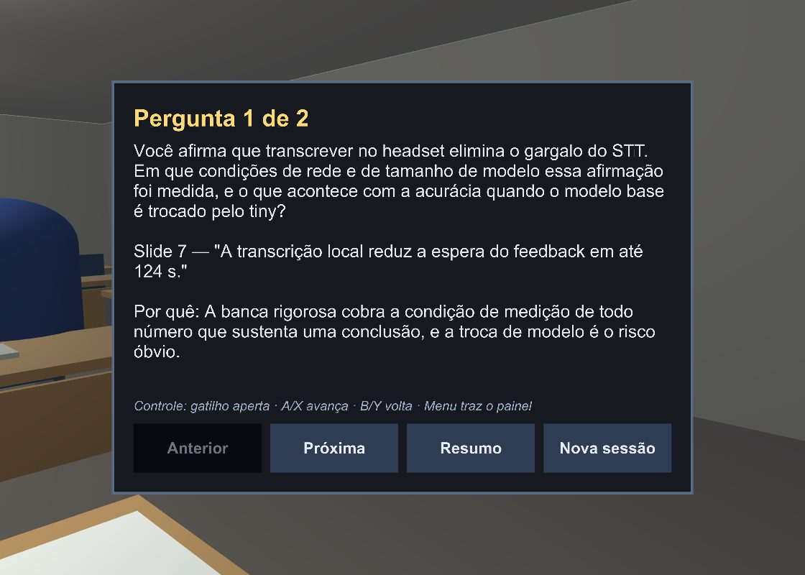 | 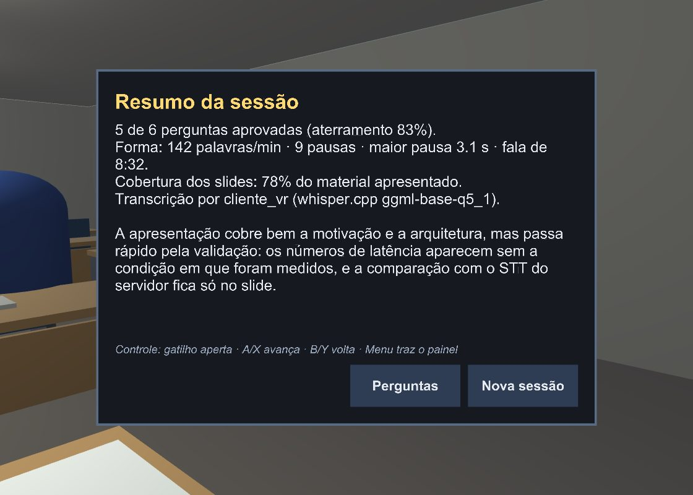 |
| Pergunta longa, com âncora e porquê, sem cortar. | O resumo que antes só o PC mostrava. |

**A luz direcional, com e sem.** Eu ia afirmar que desligar o sol "não muda a imagem" — e
todas as capturas acima já eram sem ele. Renderizei a mesma vista com e sem para conferir,
e a afirmação estava errada, para melhor: com o sol, **3% dos pixels** mudam (27.089 de
896.000 com diferença acima de 6 na soma RGB; máxima de 322), e o que muda é vazamento.

| Com o sol (como estava) | Sem o sol (agora) |
|---|---|
| 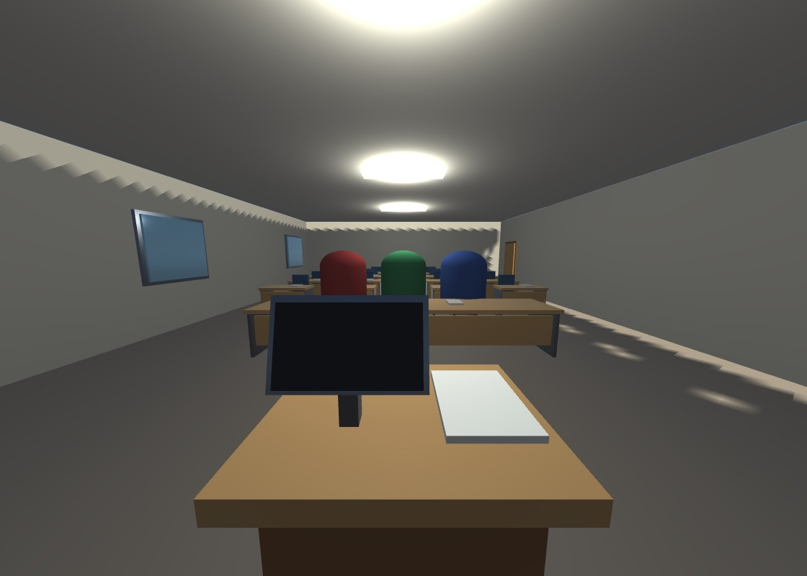 | 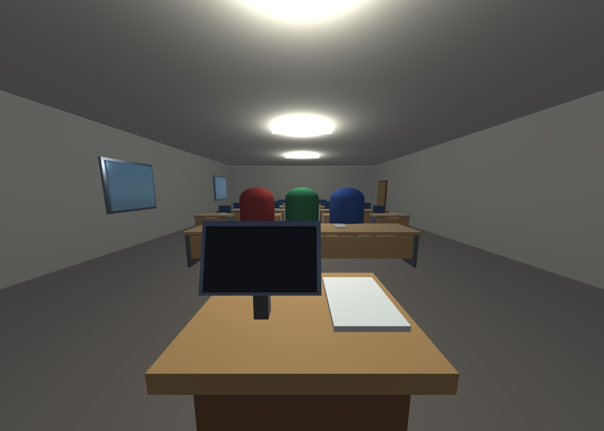 |
| Faixas serrilhadas no alto das paredes e manchas de luz no chão, à direita: a luz escapando pelas junções de paredes de 20 cm que o mapa de sombras não resolve. | A sala iluminada só pelas luminárias e pela luz ambiente. |

---

## 9. O que não foi verificado — e o roteiro para o headset

Não havia headset conectado durante esta análise. Nada do que depende de rastreamento
real foi exercitado: o raio, a pinça, a vibração, a troca controle ↔ mão, a build de
Android. O roteiro abaixo cobre isso, na ordem em que um defeito apareceria.

**Antes:** suba o backend (`docker compose up -d` na pasta `podium`) — na sessão de 20/09
ele estava fora do ar (log, linha 870) — e baixe o modelo do whisper (**Podium > Baixar o
modelo de transcrição**); ele faltava (log, linha 640).

**Pelo Link (Editor):**

1. Abra `SalaDeAula.unity` e dê Play com o Quest conectado.
2. O painel deve estar à **direita do púlpito, de frente**, com "Sala de aula" legível.
   Ao seu pé, a marca no chão.
3. Pegue os controles: a linha de ajuda deve dizer *Controle: …*. Aponte para um botão —
   ele deve clarear sob o raio — e aperte o gatilho.
4. Teste *Verificar API* e *Criar sessão*. Durante a fala, A/X e B/Y passam o slide (a tela
   da parede e o monitor do púlpito acompanham), com uma vibração curta.
5. Aperte o Menu do controle esquerdo longe do púlpito: o painel deve vir para a sua direita.
6. Largue os controles e mostre as mãos: a linha deve mudar para *Mãos: …*, o modelo do
   controle deve sumir e o raio deve sair da mão. Aponte e faça a pinça num botão.
7. Segure a pinça ~1 s apontando para o chão: o painel deve vir para perto. Segurar a pinça
   *sobre* um botão não deve movê-lo.
8. Termine uma sessão: *Pergunta 1 de N*, *Resumo*, *Perguntas* e *Nova sessão* (que deve
   voltar ao lobby).
9. No log do Editor, o relatório do OpenXR deve listar os perfis — e não mais
   `No action sets registered`.

**Na build de Android:** o app deve abrir imersivo, não como janela plana (Meta Quest
Support), e a rede deve seguir o que o README descreve em *Rede*. Repita os passos 2 a 8.

Se algo falhar, os pontos de ajuste estão no Inspector do objeto `Podium`:
`PainelEmVR` (lugar, altura dos olhos, tolerância de giro), `ComandosDoApresentador`
(tempo da pinça longa, vibração), `PodiumXRRig` (`paradoNoPulpito`) e
`SalaDeAulaCenografia` (`comMarcaNoChao`).

---

## 10. Riscos, pendências e decisões que são suas

1. **Teste no aparelho** — o item acima. É o único que pode desmentir esta análise.
2. **Malha e toque das mãos (XR Hands).** Hoje a mão aponta e aperta pelo raio, sem mão
   desenhada. Ver a mão e apertar encostando o dedo pedem `com.unity.xr.hands` e a amostra
   de mãos do XRI. Só vale se o teste mostrar que o raio não basta — o README registrava
   "pacote a defender na banca", e o raio evitou esse custo.
3. **Modelo do whisper ausente nesta máquina.** Sem ele o `WhisperManager` lança uma
   `NullReferenceException` dentro do pacote (log, linhas 640–663). A sessão segue e o
   servidor transcreve, mas o log fica sujo e a medição do whisper no XR2 não acontece.
4. **`XRGeneralSettings.asset` já estava modificado** antes desta análise, com entradas de
   WebGL que o Editor acrescentou. Não mexi. Inofensivo; decida entre commitar e descartar
   (`git checkout -- Assets/XR/XRGeneralSettings.asset`).
5. **Identificador do pacote Android vazio** (`applicationIdentifier: {}` no
   `ProjectSettings`). O Unity usa um padrão derivado de `DefaultCompany`/`podium-vr`; vale
   definir um nome próprio antes de distribuir o APK.
6. **O aviso de SSAO** vai continuar na validação enquanto o renderer de PC tiver SSAO. Não
   afeta o Quest; removê-lo mudaria a imagem no PC, e isso não foi pedido.
7. **Posição do painel para alturas diferentes.** Foi calculada para olhos a 1,6 m: o
   centro fica a 46,7° à direita e 7° abaixo da linha dos olhos, a 1,17 m; a borda esquerda
   a 21,5° do centro da visão, com folga da borda da persona mais à direita (~18,8°); e a
   borda de baixo acima do tampo do púlpito. A primeira tentativa, a 44°, encostava na
   cápsula dessa persona — as capturas mostraram, e o painel foi afastado. Para quem é bem
   mais baixo, o canto do tampo pode tapar a ponta do primeiro botão; para quem apresenta
   sentado, ajuste `lugarDoPainel` e `alturaDosOlhos` no Inspector.

### Sugestão de commits

O histórico do repositório usa commits pequenos e em português; uma divisão possível:

- `fix(xr): virar o painel para quem apresenta e tirá-lo de trás do púlpito`
- `fix(xr): ligar os perfis de controle e de mão do openxr e o meta quest support`
- `feat(xr): comandos de controle e de mão para slides, perguntas e painel`
- `feat(cenografia): marca no chão e sala fechada sem sol`
- `chore(urp): msaa 4x, sem hdr e escala 1,0 no quest`
- `test(xr): virada do painel, resumo e regras dos comandos`
- `docs: análise do vr e o headset no readme`
